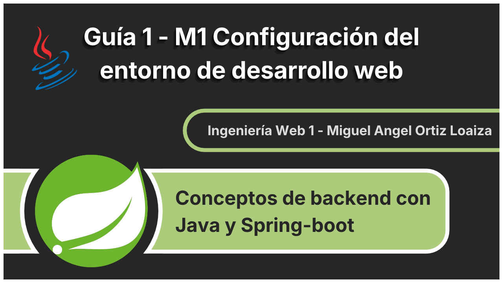

# GUÍA 1 – M1 - CONFIGURACIÓN DEL ENTORNO DE DESARROLLO WEB
****

    

## Propósito de la actividad

Preparar un entorno de desarrollo web funcional mediante la instalación y configuración de
herramientas básicas, permitiendo al estudioso crear, organizar, ejecutar y comprobar su primer
proyecto utilizando HTML5.

## Resultado de aprendizaje
Configura un entorno básico de desarrollo web y crea una estructura inicial de proyecto
aplicando buenas prácticas de organización de archivos y ejecución en el navegador.

## ¿Cómo ejecutar el proyecto?
Para ejecutar el proyecto en local, es necesario clonar este repositorio y abrir el archivo index.html en el navegador. Alternativamente, se ingresar al sitio de [GitHub Pages](https://ctrl-angelus.github.io/Ingenieria-Web-1_Guia-1/)

## Herramientas que se utilizaron
El editor de código que utilicé para esta actividad fue Neovim (Lazyvim). Para navegadores web se usó Zen (Firefox) y Brave (Chromium) y sus respectivas herramientas de desarrollador. Para Servidor local se usó http.server de python y Ngrok.

## Video
Enlace al video del proyecto: [Video](https://youtu.be/McEGIHOpQb4?si=P6syG6DVZfwjpFCV)
